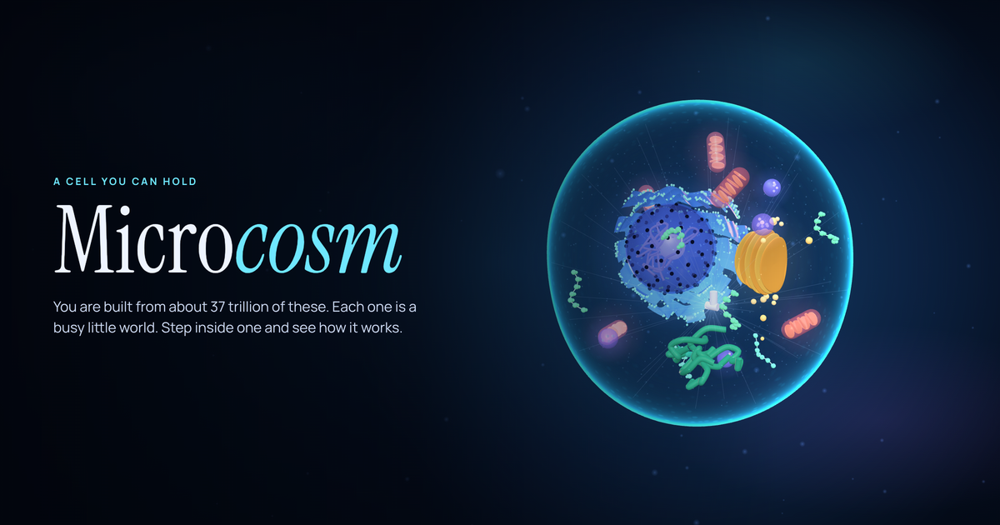

# Microcosm

**A living cell in 3D. Fly around it, meet its parts, pull them out and see what the cell does without them.**

Live: https://kate1819.github.io/microcosm/

## What you can do

- **Look around.** Drag to orbit the cell, scroll or pinch to zoom.
- **Meet a part.** Tap any part for a short card with one surprising fact, then play with it: spark the mitochondria, ship a package from the Golgi, look inside the nucleus.
- **Move it.** Drag a selected part anywhere, including right out of the cell.
- **See what breaks.** The cell's vital signs, its glow and its music all react when a part is missing.
- **Take it all apart.** One button lays every part out around the cell with its name.

There are 27 small discoveries to collect and no wrong answers.

## About

The model is a human (animal) cell with nine parts: membrane, nucleus, rough and smooth ER, Golgi, mitochondria, lysosomes, ribosomes and the centrosome. Parts are not drawn to scale. The vital-sign meters are a simplified picture of how the parts depend on each other.

Everything is one `index.html` file. The 3D scene uses three.js, and the music and sound effects are generated in the browser, so there are no audio files.
